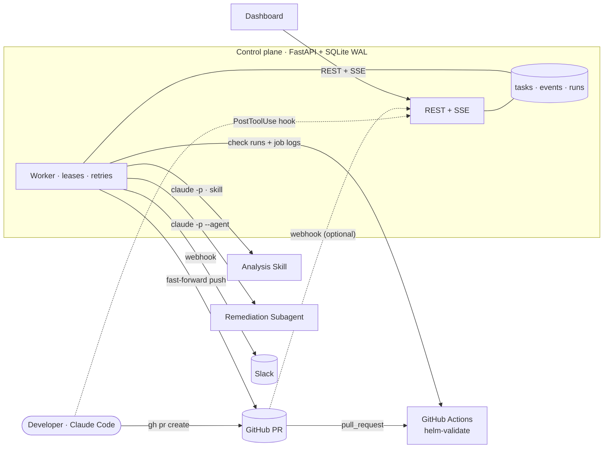
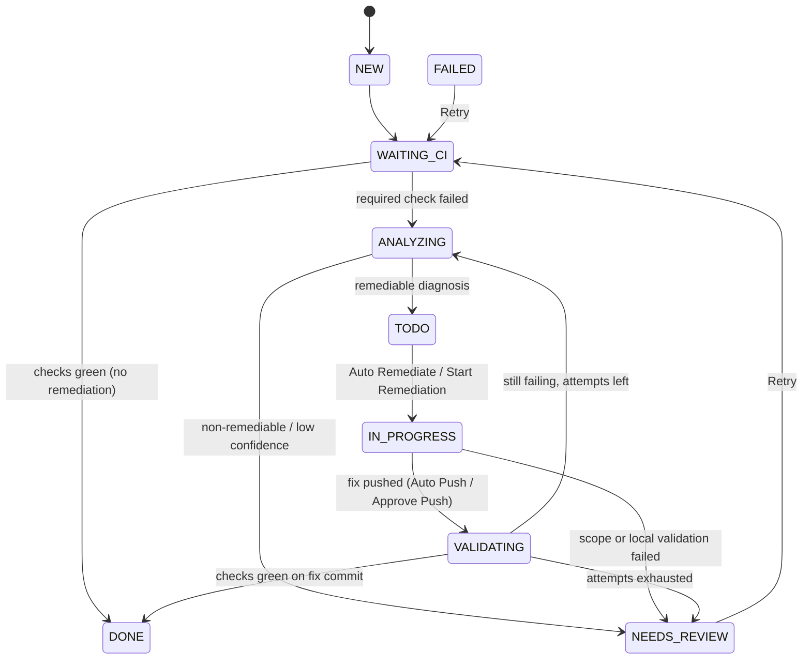
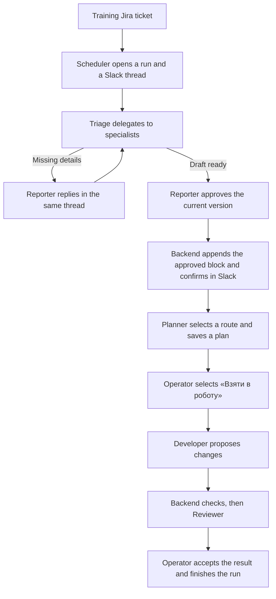

# CI Control Plane

This workshop repository includes two workflows in one dashboard. **CI Dashboard** demonstrates remediation of
Kubernetes and Helm failures in a GitHub PR. [**Jira Workflow**](#jira-workflow) takes a training ticket through
Slack clarification, reporter approval, planning, implementation and review.

**Detection → Reasoning → Autonomous Repair → Deterministic Validation → Human Visibility**

A developer opens a PR from Claude Code → a Claude Code **hook** registers it → a worker watches the real
**GitHub Actions** check → on failure a headless Claude Code **Analysis Skill** diagnoses it → a Claude Code
**Remediation Subagent** fixes it in an isolated worktree → the control plane re-validates, commits and pushes to the
same PR → GitHub Actions re-runs → the task moves to **DONE** and **Slack** receives a summary. Every step is
visible live on a Kanban dashboard.

- How it works, step by step (what is written to the DB, who decides what): [docs/HOW_IT_WORKS.md](docs/HOW_IT_WORKS.md)
- A real run, file by file (evidence bundle, agent JSON, diff, Slack payload): [docs/examples/](docs/examples/README.md)
- Architecture & security boundaries: [docs/ARCHITECTURE.md](docs/ARCHITECTURE.md)
- Workshop runbook (step-by-step live demo): [docs/RUNBOOK.md](docs/RUNBOOK.md)
- Troubleshooting: [docs/TROUBLESHOOTING.md](docs/TROUBLESHOOTING.md)
- Implementation plan & decisions: [docs/IMPLEMENTATION_PLAN.md](docs/IMPLEMENTATION_PLAN.md)

## CI architecture



### Task state machine



Kanban columns: **NEW** (NEW, WAITING_CI, ANALYZING) · **TODO** (TODO, NEEDS_REVIEW) ·
**IN PROGRESS** (IN_PROGRESS, VALIDATING) · **DONE** (DONE, FAILED). Cancel moves any active task to FAILED.

## Jira Workflow

Open **Jira Workflow** at `/jira-workflow`. The workshop uses Training Jira by default. The scheduler picks up
the paired reporter's `New` tickets, and the Slack bot opens one thread per ticket. The reporter approves a
specific draft before the backend appends it to the ticket description. The issue stays `New` in Training Jira.



The Jira Kanban shows **New → Clarification → Ready for handoff → In progress → Done**. Open a card to see the
Slack thread, draft versions, plan, diff and validation. **Timeline → Agent activity** shows delegation, tool
inputs and results, and structured JSON for runs that captured those details.

| Start here | What it covers |
|---|---|
| [Jira Workflow architecture and run guide](docs/JIRA_WORKFLOW.md) | Sequence and state diagrams, agent roles, routing, dashboard and troubleshooting |
| [Slack setup](docs/specs/jira-slack-workshop-integration-checklist.md) | Local Socket Mode, pairing and the optional shared router |
| [Workshop presentation and facilitator notes](presentation/README.md) | Slides, two live exercises and demo preparation |
| [Agent exercise without Slack or Jira](demo/jira-workshop/README.md#локальна-вправа-без-slack-і-jira) | Reproduce the same input while editing a skill or an agent profile |

## Repository layout

```text
backend/                FastAPI app, worker, SQLAlchemy models, Alembic migrations, pytest suite
  app/api/              REST, SSE stream, GitHub webhook
  app/orchestration/    state machine, worker (leases, recovery, stages), CI aggregation
  app/agents/           analysis & remediation contracts (schemas, prompts, reconciliation, scope)
  app/integrations/     GitHub REST, git worktrees, headless Claude runner, Slack
frontend/               React + TypeScript + Vite + Tailwind dashboard
control-plane.yaml      CI repository routes and Jira implementation/review routes
demo/charts/            payments-api Helm chart
demo/scenarios/         scenario definitions A/B/C
demo/scripts/           scenario.py (prepare/verify), agent_dry_run.py (rehearsal)
demo/booking/           Python booking service, test and training ticket data
demo/static-page/       static HTML/CSS training ticket data
presentation/           browser-based workshop slides and facilitator notes
.claude/hooks/          register_pr.py — PostToolUse hook
.claude/skills/         CI analysis and Jira workshop skills, runbooks and scripts
.claude/agents/         CI remediation and Jira workshop agent profiles
.github/workflows/      helm-validate (required check), ci (tests)
scripts/preflight.py    environment & integration preflight
```

## Quick start (local — recommended)

Requirements: [just](https://just.systems), Python 3.12 + [uv](https://docs.astral.sh/uv/), Node 22+ + pnpm, git, `gh`, `helm`, `kubeconform`,
Claude Code (`claude`) logged in.

```bash
brew install just helm kubeconform gh uv pnpm   # macOS
cp .env.example .env                          # set SLACK_WEBHOOK_URL for CI notifications
just install                                  # uv sync + pnpm install
just build-ui                                 # dashboard → frontend/dist
just dev                                      # API + worker + UI on http://localhost:8000
just preflight                                # in another terminal
```

Run `just` to list all recipes. Set `PORT` in `.env` if :8000 is taken (also set `PUBLIC_URL` to match —
the hook posts there). UI development with hot reload: `just dev` + `just dev-ui` → http://localhost:5173.

For Jira Workflow, configure the workshop bot in `.env` and pair from the dashboard. [Jira demo setup](docs/JIRA_WORKFLOW.md#як-пройти-демо)

### Docker Compose

```bash
cp .env.example .env   # + GITHUB_TOKEN, SLACK_WEBHOOK_URL, ANTHROPIC_API_KEY or CLAUDE_CODE_OAUTH_TOKEN
docker compose up --build
```

The container cannot reach the macOS keychain, so it needs an explicit Claude credential and a GitHub token
(git pushes over HTTPS with that token).

## CI authentication & configuration

| Integration | What is needed | How it is used |
|---|---|---|
| GitHub API | `gh auth login` (or `GITHUB_TOKEN` with `repo` scope) | read PRs, check runs, job logs, annotations |
| git push | SSH key / credential helper that can push to the PR branch | the backend pushes the fix commit (fast-forward only) |
| Claude Code | `claude` logged in (OAuth), or `ANTHROPIC_API_KEY` / `CLAUDE_CODE_OAUTH_TOKEN` | headless analysis and remediation |
| Slack | an [Incoming Webhook](https://api.slack.com/messaging/webhooks) URL in `SLACK_WEBHOOK_URL` | success / review / failure notifications |

Repositories and routes live in [`control-plane.yaml`](control-plane.yaml) — which repository is watched, and for each
failing CI check which skill, agent and validator handle it and which paths a fix may touch:

```yaml
repositories:
  - repo: brinops/ai-workshop
    routes:
      - check: helm-validate
        analysis_skill: k8s-failure-analysis
        remediation_agent: k8s-remediator
        validator: .claude/skills/k8s-failure-analysis/scripts/validate.py
        allowed_paths: ["demo/charts/**"]
```

Skills and agents use the standard `.claude/` layout; adding a domain (e.g. Terraform) means adding a skill, an
agent and a route — no code changes. See [docs/HOW_IT_WORKS.md](docs/HOW_IT_WORKS.md#adding-a-domain-eg-terraform).

Runtime settings and secrets are environment variables, documented in [`.env.example`](.env.example). Key ones:

| Variable | Default | Meaning |
|---|---|---|
| `CLAUDE_MODEL` | `sonnet` | model for both agents |
| `AGENT_MAX_BUDGET_USD` | `2.0` | per-run spend cap (`--max-budget-usd`) |
| `DEFAULT_AUTO_PUSH` | `false` | safe default: pushing requires approval |
| `RCP_API_TOKEN` | — | optional bearer token for `/api/tasks/register` |
| `GITHUB_WEBHOOK_SECRET` | — | enables `/api/webhooks/github` |

### Hook installation

The hook ships in [`.claude/settings.json`](.claude/settings.json) and is active for any Claude Code session
started in this repository:

```json
{ "hooks": { "PostToolUse": [ { "matcher": "Bash",
  "hooks": [ { "type": "command", "command": "python3 \"$CLAUDE_PROJECT_DIR/.claude/hooks/register_pr.py\"", "timeout": 45 } ] } ] } }
```

* It acts only when the Bash command contains `gh pr create` and a PR can be confirmed via `gh pr view`.
* It posts to `RCP_API_URL` (default `http://localhost:8000`); the optional token comes from `RCP_API_TOKEN` in the
  environment — never from the config file.
* If the backend is down the registration is spooled to `~/.cache/rcp/pending-registrations.jsonl` and retried on the
  next PR creation, or manually: `python3 .claude/hooks/register_pr.py --flush`.
* Register any existing PR manually: `python3 .claude/hooks/register_pr.py --register <PR URL>`.
* To use the hook in another repository, copy `.claude/hooks/register_pr.py` and the `hooks` block into that
  repository's `.claude/settings.json` (or `~/.claude/settings.json` for all projects).

Run `/hooks` inside Claude Code to confirm it is loaded.

### Automation controls

| Setting | Off | On |
|---|---|---|
| Auto Analyze | failed PR waits for **Analyze Now** | analysis starts when CI fails |
| Auto Remediate | diagnosis waits for **Start Remediation** | remediation starts after a remediable diagnosis |
| Auto Push | validated fix waits for **Approve Push** (default) | fix is pushed immediately |

`just autonomous` / `just safe` switch presets from the terminal; the dashboard has the same toggles.
The control plane **never merges** a PR.

## Demo scenarios

| ID | Error injected | Caught by | Expected class |
|---|---|---|---|
| A | mis-indented `memory:` under `resources.limits` in `values.yaml` | YAML parse | `SYNTAX_ERROR` |
| B | `replicaCount: three` | kubeconform (`spec.replicas` must be integer) | `SCHEMA_VIOLATION` |
| C | `service.targetPort: 9090` while the app listens on `app.port: 8080` | consistency check | `LOGICAL_CONFIGURATION_ERROR` |

```bash
just scenarios            # proves each scenario fails for the intended reason (and only that reason)
just scenario C         # new branch from origin/main + error + push; prints the gh pr create command
just dry-run C          # rehearse both agents locally without GitHub (costs ~$0.40)
```

Each run creates a fresh, timestamped branch, so scenarios are independently repeatable.

## Testing

```bash
just test     # backend pytest (fakes for GitHub/agents/Slack + real helm/kubeconform) and frontend vitest
just lint
```

## Safety summary

* Agents run headless with `--permission-mode dontAsk` and explicit allowlists — no permission bypass.
* Analysis: `Read, Grep, Glob` only. Remediation: `Edit` restricted to `<worktree>/demo/charts/**` and one Bash
  command (the trusted validator). No git, network, or other shell access. Verified by a live negative test.
* Skills/agents are loaded from the operator's checkout, not from the PR under analysis.
* PR text, file contents and CI logs are passed as untrusted data; secrets are scrubbed from the agent
  environment and redacted from logs, events, comments and Slack payloads.
* The backend re-checks the diff scope and re-runs validation before committing; pushes are fast-forward only,
  verified against the expected SHA, and refused for protected branches.
