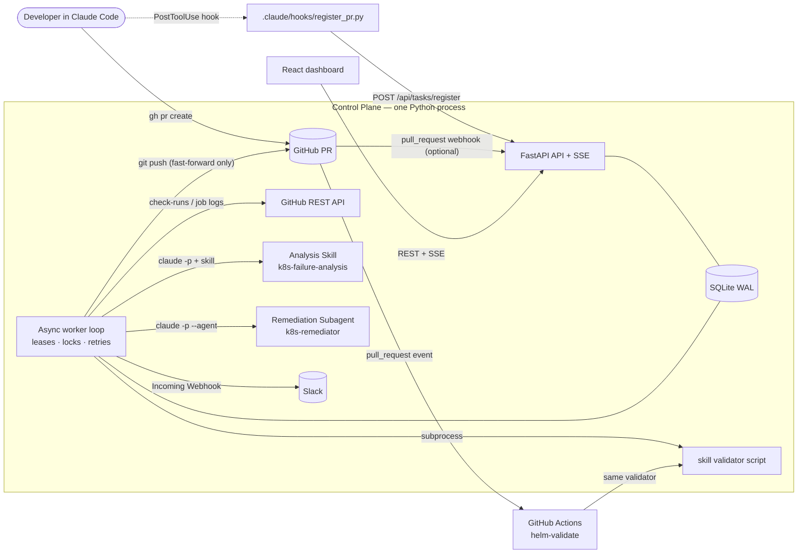
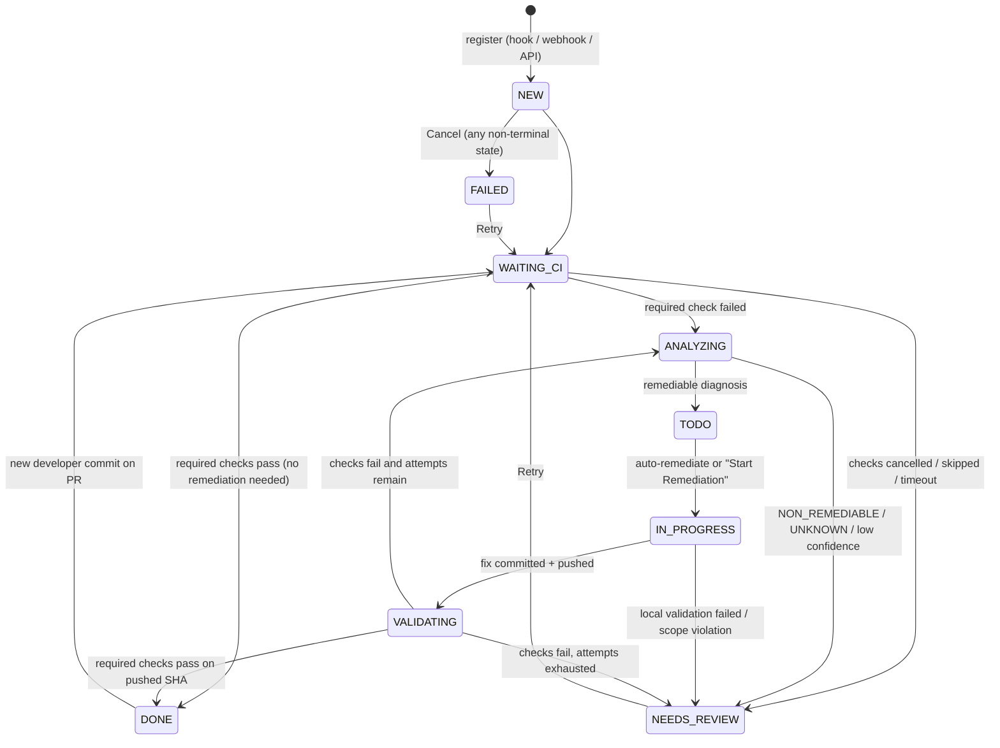

# AI Remediation Control Plane — Architecture

## 1. Goal

Demonstrate **Detection → Reasoning → Autonomous Repair → Deterministic Validation → Human Visibility**
for broken Helm/Kubernetes configuration in a GitHub Pull Request, using real GitHub Actions,
real Claude Code (headless), and real Slack.

## 2. Component overview

| Component | Location | Responsibility |
|---|---|---|
| PR registration hook | `.claude/hooks/register_pr.py` | Detects successful `gh pr create` in Claude Code, confirms the PR via `gh`, registers it idempotently, spools on backend downtime |
| API | `backend/app/api/` | Task CRUD, actions, settings, health, GitHub webhook, SSE stream; serves the built UI |
| Orchestration | `backend/app/orchestration/` | State machine, worker loop, stage handlers, leases, recovery |
| Integrations | `backend/app/integrations/` | GitHub REST client, git worktree manager, Slack client, Claude CLI runner |
| Agents | `backend/app/agents/` | Prompt construction, output schemas, deterministic reconciliation |
| Validator | `.claude/skills/<skill>/scripts/validate.py` | Single source of truth for validation — used by CI, the backend and the agent |
| Routing config | `control-plane.yaml` | Repositories and routes: failed CI check → skill, agent, validator, allowed paths |
| Analysis Skill | `.claude/skills/k8s-failure-analysis/` | Classify failure + root cause + fix plan (read-only tools) |
| Remediation Subagent | `.claude/agents/k8s-remediator.md` | Apply the minimal fix in an isolated worktree (edit-only, allowlisted paths) |
| UI | `frontend/` | Kanban, task detail, timeline, diff, logs, controls, presentation mode |
| Demo | `demo/` | Helm chart + 3 reproducible failure scenarios |

## 3. Task state machine

Cross-cutting flags (not states): `paused`, `cancel_requested`, `pending_action`
(`analyze` / `remediate` / `push` — a stage waiting for human approval).

Kanban mapping:

| Column | Internal states |
|---|---|
| NEW | NEW, WAITING_CI, ANALYZING |
| TODO | TODO, NEEDS_REVIEW |
| IN PROGRESS | IN_PROGRESS, VALIDATING |
| DONE | DONE, FAILED |

## 4. Execution model

* **One process** (`uvicorn app.main:app`) runs the API and the worker loop (asyncio task).
  The worker can also run standalone (`python -m app.worker`) — all coordination happens in SQLite,
  so the two modes behave identically.
* **Atomic claiming**: a stage is claimed with a single conditional
  `UPDATE tasks SET lease_owner=?, lease_expires_at=? WHERE id=? AND state=? AND (lease_owner IS NULL OR lease_expires_at < now)`.
  Exactly one worker can win. Because a task *is* a PR (`UNIQUE(repo, pr_number)`), the lease is also the PR-level lock.
* **Heartbeats** extend the lease while an agent runs; an expired lease means the worker died.
* **Recovery**: on start-up and every tick, expired leases are released, the interrupted agent run is marked
  `interrupted`, and the stage is re-queued (stages are idempotent: analysis is pure; remediation starts from a fresh worktree
  at the expected SHA; a push that already landed is detected by comparing the remote head with the recorded fix commit).
* **Agent subprocesses** run in their own process group with a hard timeout; Pause/Cancel kill the group.
* **SSE** tails the `events` and `agent_log_lines` tables by id, so it works across processes and restarts.

## 5. Security boundaries

| Boundary | Control |
|---|---|
| PR content, PR body, CI logs are untrusted | Passed to agents as *files to analyse*, wrapped in explicit "data, not instructions" framing; logs are size-limited and secret-redacted |
| Agent configuration | Skills/agents are loaded from the **operator's checkout** (`cwd` = control-plane repo), never from the PR worktree — a PR cannot change the agent's instructions |
| Analysis tools | `Read, Grep, Glob` only, `--permission-mode dontAsk` (anything not allowlisted is denied) |
| Remediation tools | `Read, Grep, Glob, Edit` limited to `Edit(//<worktree>/demo/charts/**)` + the validator command; **no git, no network, no shell** |
| Scope enforcement | The backend re-checks the produced diff: only the route's `allowed_paths` globs, ≤ `max_changed_lines` (`control-plane.yaml`); otherwise NEEDS_REVIEW |
| Git | Only the backend commits and pushes; fast-forward push of `HEAD:refs/heads/<pr-branch>` after verifying the remote head equals the expected SHA; protected branches are refused; **never merges** |
| Secrets | Not stored in hook config or DB; redaction filter on all logs/events/Slack payloads; `.env` git-ignored |
| Inbound | Hook endpoint optionally requires `RCP_API_TOKEN`; GitHub webhook requires HMAC (`GITHUB_WEBHOOK_SECRET`) |
| Spend | `--max-budget-usd` and wall-clock timeout per agent run; bounded remediation attempts |

## 6. Determinism over LLM opinion

The route's validator (`.claude/skills/k8s-failure-analysis/scripts/validate.py`) emits machine-readable findings (`RCP-FINDING {json}` lines in CI logs, GitHub annotations,
JSON locally) with a category: `SYNTAX_ERROR`, `SCHEMA_VIOLATION`, `LOGICAL_CONFIGURATION_ERROR`.
The backend extracts these from the real job log **before** invoking the agent and passes them as evidence.
After analysis, `reconcile()` enforces: if deterministic evidence exists and the LLM disagrees,
the deterministic category wins and the disagreement is recorded in the diagnosis.
A task is DONE only when GitHub reports success for every required check on the exact pushed SHA.

## 7. Integration assumptions

* GitHub auth: `GITHUB_TOKEN` or the `gh` CLI session (`gh auth token`). Push uses the local git credentials.
* Claude Code auth: the local `claude` login (OAuth/keychain) or `ANTHROPIC_API_KEY` / `CLAUDE_CODE_OAUTH_TOKEN`.
* Slack: one Incoming Webhook URL (`SLACK_WEBHOOK_URL`).
* The target repository contains `.github/workflows/helm-validate.yaml`; its check run is named `helm-validate`.
