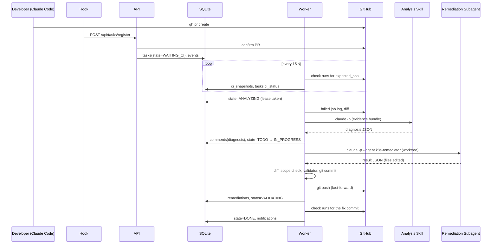

# How it works

The short version: **the orchestrator is plain Python code (the worker), not an agent.** Agents never decide
what happens next. The worker calls them for exactly two jobs — *diagnose* and *fix* — they return JSON,
and the worker decides the next step. Everything that happens is written to SQLite (`var/rcp.db`), and the
worker decides what to do next purely by reading those rows.

## Who does what

| Component | What it is | Role |
|---|---|---|
| **Hook** | `.claude/hooks/register_pr.py`, runs inside Claude Code | Notices `gh pr create`, registers the PR via the API |
| **Worker (orchestrator)** | Python loop in the backend, ticks every 2 s | Polls CI, launches agents, commits, pushes, changes states |
| **Analysis Skill** | One headless `claude -p` run | Reads evidence files, returns a diagnosis as JSON. Read-only |
| **Remediation Subagent** | One headless `claude -p --agent` run | Edits chart files in a worktree, returns a result as JSON |
| **Validator** | `.claude/skills/k8s-failure-analysis/scripts/validate.py` | Deterministic checks — same code in CI, backend and agent |
| **`control-plane.yaml`** | Routing config | Which repos are watched; failed check → skill, agent, validator, allowed paths |
| **SQLite** | `var/rcp.db` | The single source of truth: task state, events, logs |
| **Dashboard** | React | Only *displays* DB rows (live via SSE); buttons only change DB fields |



## Step by step — what is written where

### 1. Registration → `NEW` → `WAITING_CI`

The hook sees the output of `gh pr create`, confirms the PR with `gh pr view`, and calls
`POST /api/tasks/register`. The backend **re-checks the PR on GitHub itself** (it does not trust the
caller) and writes:

- `tasks`: one row — repo, PR number, branch, `head_sha`, `expected_sha` (the commit whose CI we act on),
  `state=NEW`, then immediately `state=WAITING_CI`;
- `events`: `registered`, `state_changed`.

A second registration of the same PR does not create a row (`UNIQUE(repo, pr_number)`); it only records a
`registration_duplicate` event. The GitHub webhook (optional) calls the same function.

### 2. Waiting for CI — `WAITING_CI`

Every 15 s the worker selects tasks in `WAITING_CI` and asks GitHub for the check runs of
**exactly `expected_sha`**. The checks that count are the `check` names of the repository's routes in
`control-plane.yaml`. It writes:

- `ci_snapshots`: a snapshot whenever the check states change;
- `tasks.ci_status`: `pending` / `failure` / `success` / `cancelled` / `skipped`.

Then the worker decides — **no agent involved**:

| CI result | Next |
|---|---|
| `success` | `DONE` (`passed_without_remediation`) — no agent ever runs |
| `failure`, Auto Analyze on | `ANALYZING` — the failed check selects the **route** (stored in `tasks.route`) |
| `failure`, Auto Analyze off | stays `WAITING_CI` with `pending_action=analyze` → waits for **Analyze Now** |
| `cancelled` / `skipped` / timeout | `NEEDS_REVIEW` (cannot prove validity) |

### 3. Analysis — `ANALYZING`

1. **Claim.** One atomic `UPDATE tasks SET lease_owner=… WHERE id=? AND state='ANALYZING' AND lease is free`.
   Only one worker can win; the lease is also the per-PR lock. A heartbeat extends it while the agent runs.
2. **Collect evidence deterministically** (no LLM yet):
   - the failed job log from GitHub, from which the `RCP-FINDING {json}` lines printed by the validator are
     extracted — these carry the *deterministic* category;
   - the PR diff and changed files;
   - a fresh git worktree at exactly `expected_sha`;
   - a local validator run on that worktree → `validation_runs` (`pre-analysis`).
   
   Everything goes into `var/runs/task-<id>/analysis-<run>/` (`context.json`, `ci-log.txt`, `pr.diff`,
   `local-validation.json`).
3. **Run the agent.** `claude -p` with the `k8s-failure-analysis` skill, tools `Read, Grep, Glob` only,
   `--permission-mode dontAsk`, `--json-schema` for the output. Every tool call is stored in
   `agent_log_lines` (with full input/output in `detail`), the run itself in `agent_runs`.
4. **Validate and reconcile.** The JSON is validated with Pydantic, then reconciled with the deterministic
   findings: if the validator says `LOGICAL_CONFIGURATION_ERROR` and the model says something else, **the
   validator wins** (a `classification_overridden` event is recorded).
5. **Decide.** Written: `comments` (`kind=diagnosis` — Markdown + full JSON), `tasks.classification`,
   `confidence`, `root_cause`. Then:
   - fix is safe (remediable class, confidence ≥ 0.6, only allowlisted files, agent agrees) → `TODO`;
   - otherwise → `NEEDS_REVIEW` (+ Slack notification).

If the agent crashes or returns invalid JSON, the stage is retried once (`analysis_runs`), then `FAILED`.

### 4. Fix — `TODO` → `IN_PROGRESS`

With Auto Remediate on, the worker moves the task to `IN_PROGRESS` and consumes an attempt
(`attempt 1/2`); with it off, it sets `pending_action=remediate` and waits for **Start Remediation**.

1. Verify on GitHub that the PR head is still `expected_sha` (the developer may have pushed meanwhile —
   then the task re-targets the new commit and goes back to `WAITING_CI`).
2. Fresh worktree `var/worktrees/task-<id>-fix-a<attempt>` at `expected_sha`.
3. `claude -p --agent k8s-remediator` with the approved diagnosis. Allowed: `Edit` only under
   `<worktree>/demo/charts/**`, and exactly one Bash command — the trusted validator. No git, no network.
4. **Deterministic post-checks by the worker** (whatever the agent claims):
   - compute the diff;
   - scope check: only the route's `allowed_paths`, no deletions, ≤ `max_changed_lines`;
   - run the validator again → `validation_runs` (`post-remediation`);
   - if everything passes → `git commit` (author "RCP Remediation Agent").
5. Written: `remediations` (diff, files, `scope_ok`, validation report, `commit_sha`,
   `push_status=pending_approval`) and a `comments` row (`kind=remediation`). Any problem → `NEEDS_REVIEW`
   and the commit is discarded.

### 5. Push

- Auto Push on → push immediately. Off → `pending_action=push`; the **Approve Push** button sets
  `remediations.push_status=approved` and the worker pushes on its next tick.
- Before pushing the worker checks: branch is not protected, PR is open, PR head is still `expected_sha`.
- Fast-forward `git push` to the PR branch (never force, never merge).
- `tasks.expected_sha` ← the fix commit, `state=VALIDATING`, event `pushed`.

### 6. Verifying the fix — `VALIDATING`

The worker polls CI again, now for the fix commit:

| CI result | Next |
|---|---|
| `success` | `DONE` (`remediated`) + `notifications` row → Slack |
| `failure`, attempts left | back to `ANALYZING` with the new logs |
| `failure`, attempts exhausted | `NEEDS_REVIEW` + Slack |

## How the worker knows what to do next

It keeps **no state in memory**. Every tick (2 s) it runs a few queries:

| Query | Action |
|---|---|
| `WAITING_CI` / `VALIDATING` tasks due for a CI check | poll GitHub |
| `ANALYZING` tasks without a live lease | run analysis |
| `TODO` tasks while Auto Remediate is on | move to `IN_PROGRESS` |
| `IN_PROGRESS` tasks without a fix, or with an approved fix | run remediation / push |
| leases whose `lease_expires_at` has passed | release, mark the run `interrupted`, re-run the stage |

That is why a crash or restart resumes exactly where it stopped (the timeline shows "Recovered …"), and why
the dashboard buttons are so simple: they only change fields on `tasks` (`state`, `paused`,
`pending_action`, `cancel_requested`) or `remediations.push_status`, and the worker reacts on the next tick.
**Pause** lets a running agent finish but starts nothing new; **Cancel** kills the agent's process group.

Look at it live:

```bash
sqlite3 var/rcp.db "select id,state,pending_action,attempt,ci_status,lease_owner from tasks"
sqlite3 var/rcp.db "select ts,type,message from events where task_id=5"
sqlite3 var/rcp.db "select kind,status,num_turns,cost_usd from agent_runs where task_id=5"
```

## Tables at a glance

| Table | One row per | Written by |
|---|---|---|
| `tasks` | PR | API (register, buttons), worker (every transition) |
| `events` | anything that happened (audit log, timeline) | everyone, via `record_event` |
| `ci_snapshots` | observed change of CI state for a commit | worker |
| `agent_runs` | headless Claude Code run | worker |
| `agent_log_lines` | agent message / tool call / tool result | worker (streamed from `stream-json`) |
| `comments` | diagnosis or remediation report | worker |
| `validation_runs` | local validator run | worker |
| `remediations` | fix attempt (diff, commit, push status) | worker, Approve Push button |
| `notifications` | Slack message (queued → sent / failed / skipped) | worker |
| `settings` | automation toggles | API |
| `worker_heartbeats` | live worker | worker |

---

## How does it "know" it is Helm? — `control-plane.yaml`

Nothing domain-specific is hard-coded in the backend. Domain knowledge lives in the standard `.claude/` layout,
and `control-plane.yaml` only wires it together:

```text
control-plane.yaml                                    repos → routes
.claude/skills/k8s-failure-analysis/SKILL.md          Analysis Skill
.claude/skills/k8s-failure-analysis/scripts/validate.py   validator (CI, backend and agent run this)
.claude/agents/k8s-remediator.md                      Remediation Subagent
```

```yaml
repositories:
  - repo: brinops/ai-workshop
    protected_branches: [main, master, "release/*", production]
    routes:
      - check: helm-validate                 # name of the CI check run
        analysis_skill: k8s-failure-analysis
        remediation_agent: k8s-remediator
        validator: .claude/skills/k8s-failure-analysis/scripts/validate.py
        allowed_paths: ["demo/charts/**"]
        max_changed_lines: 40
        max_attempts: 2
```

How a task is routed:

1. Only repositories listed in the file can be registered (others get HTTP 403).
2. The repository's route `check` names are its **required checks**.
3. When one of them fails, that check selects the route → `tasks.route` (event `route_selected`).
4. Every stage then uses the route: the skill named in the analysis prompt, `--agent <remediation_agent>`,
   the validator for local validation and as the agent's only allowed command, `allowed_paths` for the
   agent's `Edit` permission **and** for the backend's scope check on the diff, `max_changed_lines`,
   `max_attempts`, and the repository's `protected_branches`.
5. A task whose route is missing (config changed, repo removed) goes to `NEEDS_REVIEW` — it is never guessed.

The file is validated at startup (Pydantic schema + every skill, agent and validator must exist); a broken
config stops the service with a clear error. `GET /api/config` shows the active configuration.

### Why routing is not left to skill/agent descriptions

Descriptions are for *interactive* Claude Code, where the model picks a skill itself. Here the route is chosen
by the failed check name — deterministically — because a prompt-injected PR must not be able to steer the
pipeline to a different agent. For the same reason `allowed_paths` is in the config, not in the agent file: it
is the boundary the backend enforces on the agent's output, so the agent cannot declare its own permissions.

### Adding a domain (e.g. Terraform)

1. `.claude/skills/terraform-failure-analysis/SKILL.md` — how to diagnose Terraform failures, same JSON
   output contract.
2. `.claude/skills/terraform-failure-analysis/scripts/validate.py` — runs e.g. `terraform fmt -check`,
   `terraform validate`, `tflint`; prints `RCP-FINDING {json}` lines with a `category`; supports
   `--format json` (report `{valid, charts|targets: [{findings: [...]}]}`); exit 1 on findings.
3. `.claude/agents/terraform-remediator.md` — the fixing agent.
4. A CI job named `terraform-validate` that runs the same validator with `--format github`.
5. A route in `control-plane.yaml`:

   ```yaml
       routes:
         - check: terraform-validate
           analysis_skill: terraform-failure-analysis
           remediation_agent: terraform-remediator
           validator: .claude/skills/terraform-failure-analysis/scripts/validate.py
           allowed_paths: ["infra/**"]
   ```

No backend code changes. The skills and agents are always loaded from the control plane's own checkout
(copied into a clean agent home before each run), never from the PR being analysed — otherwise a PR could
rewrite the instructions of the agent that reviews it.
