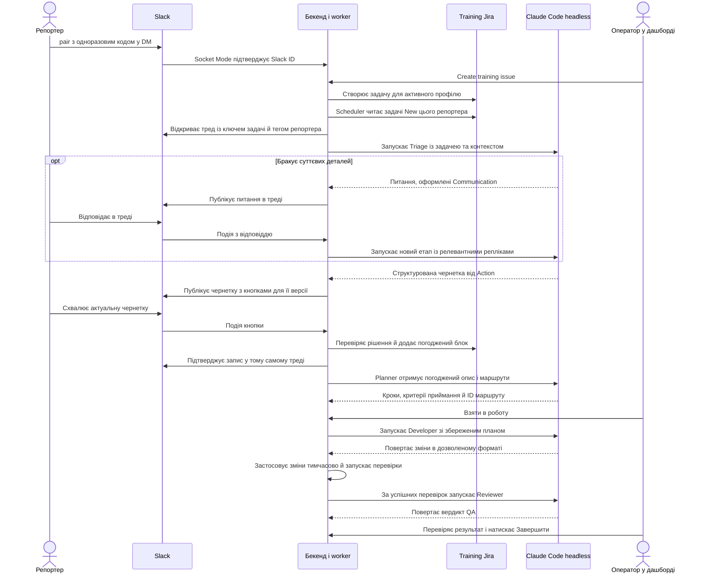
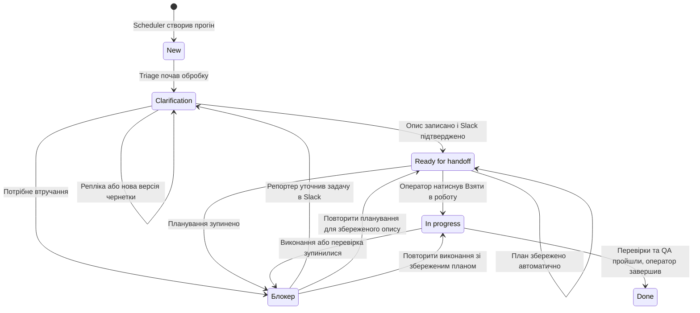

# Jira Workflow — архітектура й запуск

Jira Workflow — навчальний сценарій від нового тікета до перевірених змін. Репортер уточнює задачу й погоджує опис у Slack. Після запису в Jira бекенд автоматично готує план. Оператор запускає виконання й приймає результат у дашборді. Сценарій працює з локальною Training Jira. Для підключення Jira Cloud потрібні окремий адаптер, доступ до тестового проєкту й перевірка запису. [Чекліст інтеграції](specs/jira-slack-workshop-integration-checklist.md#4-що-попросити-для-справжньої-jira) · [CI Control Plane](ARCHITECTURE.md)

## Як проходить тікет

Якщо даних достатньо, Triage одразу готує чернетку. Якщо після першої відповіді бракує суттєвої деталі, доступний один додатковий раунд уточнення. Кнопка **«Попросити правки»** відкриває етап редагування в тому самому треді. Після коментаря репортера бот публікує нову версію зі своїми кнопками.

SQLite зберігає зв’язок між профілем, задачею і Slack-тредом, а також вхідні події, версії чернетки, рішення та операції. Ключ джерела й задачі захищає від повторного створення прогону, ID подій — від повторної обробки доставки, ID операції запису — від повторного додавання того самого блока. Перед записом бекенд також звіряє Slack ID репортера, актуальну версію і редакцію опису, від якої зроблено чернетку. [Моделі SQLite](../backend/app/models/jira_workflow.py) · [Контракти й приклади payload’ів](specs/jira-slack-workshop-contracts.md)

## Стани на дошці

| Колонка | Стан або умова |
|---|---|
| **New** | `discovered`. Scheduler створив прогін і поставив відкриття треду в чергу. |
| **Clarification** | Уточнення, очікування схвалення або правок, схвалення й запис до підтвердження в Slack. Тут також відображається `needs_intervention` із причиною блокера. |
| **Ready for handoff** | Погоджений блок записаний і підтверджений у Slack. Планування запускається автоматично. Кнопка **«Взяти в роботу»** активна після збереження плану. |
| **In progress** | Developer виконує план, бекенд перевіряє зміни, Reviewer надає вердикт. Після успіху прогін чекає на оператора. |
| **Done** | Оператор натиснув **«Завершити»** після проходження перевірок і QA. |

Колонки показують внутрішній стан прогону. Статус задачі в Training Jira весь час лишається `New`. [Код дошки](../frontend/src/pages/JiraWorkflowPage.tsx) · [Дії з прогоном](../backend/app/api/workshop_runs.py)

## Хто що вирішує

| Роль | Вхід і результат |
|---|---|
| [Triage](../.claude/agents/workshop-triage.md) | Визначає потрібних спеціалістів за гілкою діалогу. Повертає бекенду один структурований результат етапу. |
| [Investigation](../.claude/agents/workshop-investigation.md) | Збирає факти, відрізняє їх від тверджень репортера й знаходить прогалини. |
| [Communication](../.claude/agents/workshop-communication.md) | Формулює повідомлення для Slack за правилами [Tone of Voice](../.claude/skills/workshop-tone-of-voice/SKILL.md). |
| [Action](../.claude/agents/workshop-action.md) | Складає структурований блок опису для схвалення. |
| [Planner](../.claude/agents/workshop-planning.md) | Отримує погоджений опис і перелік маршрутів. Повертає ID маршруту, кроки та критерії приймання. |
| [Developer](../.claude/agents/workshop-developer.md) | Повертає зміни за планом і контрактом маршруту. |
| [Reviewer](../.claude/agents/workshop-reviewer.md) | Після автоматичних перевірок звіряє diff і їхні фактичні результати з критеріями плану. Для HTML виконує скрипт зі skill [Page Review](../.claude/skills/workshop-page-review/SKILL.md). |

Бекенд визначає етап, запускає Claude Code headless з обмеженим набором інструментів і перевіряє результат за схемою. Triage делегує спеціалістам під час окремого виклику. Для наступної репліки бекенд відкриває новий headless-виклик і передає збережений контекст. Planner, Developer і Reviewer запускаються окремими етапами. Бекенд публікує повідомлення, перевіряє схвалення й робить запис у Jira. [Runner діалогу](../backend/app/orchestration/workshop_runner.py) · [Планування й виконання](../backend/app/orchestration/booking_repair.py)

### Маршрути виконання

Planner обирає ID із `jira_routes` у [`control-plane.yaml`](../control-plane.yaml). Worker зберігає з планом ID, тип реалізації та імена з `execution_agent` і `qa_agent`. Обидва маршрути наразі використовують ті самі профілі Developer і Reviewer.

| Маршрут | Межі змін | Перевірка |
|---|---|---|
| `booking-backend` | Тіло `BookingService.reserve` у навчальній фікстурі | Python-тест відтворення й рев’ю за критеріями плану |
| `static-page` | `demo/static-page/index.html` і `demo/static-page/styles.css` | Локальна перевірка структури й рев’ю зі скриптом Page Review |

Для спеціалізованої ролі додай профіль у `.claude/agents/` і вкажи його ім’я в потрібному маршруті. Профіль має дотримуватися чинного контракту результату. Для нового типу виконання додай у бекенді підтримку його формату результату, меж файлів і перевірок. Зміни створюються в тимчасовій робочій папці, а diff і результати перевірок зберігаються в прогоні. [Конфігурація маршрутів](../backend/app/control_plane.py) · [Виконання за маршрутом](../backend/app/orchestration/booking_repair.py)

## Як пройти демо

1. Встанови залежності через `just install` і збери дашборд через `just build-ui`. Підготуй доступ Claude Code до моделі та Slack-застосунок за [чеклістом Socket Mode](specs/jira-slack-workshop-integration-checklist.md#локальний-socket-mode-для-одного-учасника). Для одного ноутбука бекенд отримує вхідні події через вихідне з’єднання зі Slack. Для кількох ноутбуків є [режим із одним приймачем і приватним маршрутизатором](specs/jira-slack-workshop-integration-checklist.md#socket-mode-для-кількох-ноутбуків-у-приватній-мережі).
2. Запусти `just dev` із кореня. Відкрий [Jira Workflow на localhost](http://localhost:8000/jira-workflow). Згенеруй одноразовий код і надішли `pair <код>` боту в DM. Дочекайся **Slack connected**.
3. У **Create training issue** вибери **Use booking example** або **Use page example**. Відкрий картку й перейди в Slack-тред. Дай відповідь на питання за потреби, переглянь чернетку й схвали її як репортер.
4. Перевір у **Overview**, що Jira зберегла вихідний опис і погоджений блок, а в **Timeline** є схвалення і підтвердження в Slack. Після появи **Plan** натисни **«Взяти в роботу»**. Перевір **Diff** і **Validation**, потім натисни **«Завершити»**.

Для вправи зі skill без Slack використовуй [локальний headless-прогін](../demo/jira-workshop/README.md#локальна-вправа-без-slack-і-jira). Порівнюй два прогони з однаковими вхідними даними й однією правкою в `.claude/`. [Слайди й нотатки ведучого](../presentation/README.md)

## Діагностика прогону

| Де дивитися | Що шукати |
|---|---|
| **Overview**, **Drafts** і **Slack** | Опис Jira, поточну версію чернетки, попередні версії та посилання на тред. |
| **Timeline → All events** | Відкриття треду, репліки, рішення репортера, запис у Jira, підтвердження в Slack і блокери. |
| **Timeline → Agent activity** | Старт і завершення етапів та сабагентів, вхід і результат викликів інструментів і **Structured output** із JSON етапу. Деталі журналу можуть бути скорочені. Прогони з попередньої версії показують лише події, які тоді записувалися. |
| **Plan**, **Diff** і **Validation** | Вибраний маршрут, критерії приймання, запропоновані зміни, фактичні результати тестів і вердикт QA. |

Якщо кнопка схвалення або репліка не рухає прогін, звір репортера, тред і версію в **All events**, потім перевір [доставку подій у Socket Mode](specs/jira-slack-workshop-integration-checklist.md#вхідні-події-у-локальному-socket-mode). Якщо Planner не знаходить відповідного маршруту або виконання зупинилося, картка показує причину, а бот за наявності треду повідомляє в ньому причину й наступний крок. Зміна обсягу через Slack проходить через нову чернетку, повторне схвалення й новий план. Коли доречний технічний повтор, у картці доступна відповідна кнопка. [Обробка блокерів](../backend/app/orchestration/workshop_blockers.py) · [Запис деталей інструментів](../backend/app/orchestration/workshop_trace.py)
