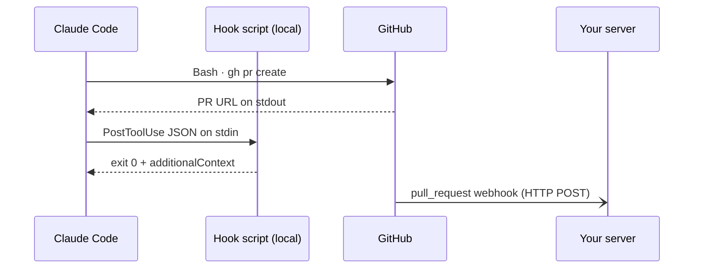

<HeroFlow />

<div class="hero-copy">
  <div class="eyebrow">Claude Code · workshop keynote</div>
  <h1 class="hero-title">From Broken PR<br><span class="grad-text">to Autonomous Recovery</span></h1>
  <p class="hero-sub">Claude Code Hooks, Headless Agents, Skills &amp; Validation Gates</p>
  <div class="hero-meta mono">
    <span>hooks</span><i /><span>claude -p</span><i /><span>skills</span><i /><span>subagents</span><i /><span>deterministic gates</span>
  </div>
</div>

<!--
**Час: ~1 хв.** Відкриваємо без поспіху: дати аудиторії 3–4 секунди подивитися на граф позаду — це і є весь сюжет доповіді. Червоний вузол «CI ✗» ліворуч, зелений «CI ✓» праворуч, між ними — hook, skill, subagent і валідація.

Що сказати:
- «Сьогодні ми пройдемо шлях від зламаного pull request до відновлення, яке не потребує людини для рутинних випадків — але ніколи не обходить людину для неоднозначних».
- Ключове слово в підзаголовку — *Validation Gates*. Уся доповідь про те, як зробити AI-автоматизацію такою, якій можна довіряти.
- Формат: ~25 хвилин концепцій, потім 10–15 хвилин живого демо на справжніх GitHub Actions, справжньому Claude Code і справжньому Slack.

Перехід: «Почнімо з того, як це виглядає сьогодні в більшості команд».
-->

---
clicks: 7
---

<div class="eyebrow">01 · The problem</div>

# The traditional workflow

<p class="lede">CI is excellent at detecting a failure. Everything after that is a person.</p>

<AnimatedWorkflow
  class="mt-6"
  :step="$clicks"
  :steps="[
    { label: 'Developer', sub: 'writes a change', icon: 'i-lucide-laptop' },
    { label: 'Pull Request', sub: 'gh pr create', icon: 'i-lucide-git-pull-request' },
    { label: 'CI Failure', sub: 'helm-validate ✗', icon: 'i-lucide-circle-x', tone: 'fail' },
    { label: 'Manual Investigation', sub: 'open logs, reproduce', icon: 'i-lucide-search', tone: 'human' },
    { label: 'Fix', sub: 'edit values.yaml', icon: 'i-lucide-pencil', tone: 'human' },
    { label: 'Push', sub: 'git push', icon: 'i-lucide-upload', tone: 'human' },
    { label: 'Re-run CI', sub: 'wait again', icon: 'i-lucide-rotate-cw' },
  ]"
/>

<!--
**Час: ~2 хв.** Кожен клік додає крок. Не поспішати — аудиторія має впізнати свій вівторок.

Ключові думки:
- Перші три кроки (Developer → PR → CI Failure) вже автоматизовані: CI виявляє проблему за хвилини.
- Кроки 4–6 — помаранчеві: це людська робота. Context switch, відкрити job log, знайти потрібний рядок серед сотень, відтворити локально, виправити, запушити.
- На останньому кліку з'являється дужка «human in the loop» і петля «wrong guess? repeat» — якщо перша гіпотеза хибна, цикл повторюється, і кожна ітерація коштує ще одного очікування CI.

Важливо: не називати конкретних цифр часу — вони залежать від команди. Краще запитати зал: «Скільки з вас за останній тиждень виправляли YAML-відступ, на який впав CI?»

Можливе питання: «Хіба pre-commit hooks не вирішують це?» — Частково, для синтаксису. Але логічні помилки (як port mismatch, який ми покажемо) pre-commit зазвичай не ловить, і він не допоможе, коли PR відкрив хтось інший.

Перехід: «Що, якщо проміжок між "впало" і "виправлено" заповнить не людина, а агент — але під контролем?»
-->

---
clicks: 3
---

<div class="eyebrow">01 · The problem</div>

# The opportunity

<OpportunityLanes :step="$clicks" />

<!--
**Час: ~2 хв.** Три кліки — три частини тези. Це головний слайд-аргумент усієї доповіді, його варто проговорити повільно.

1. **CI tells us what failed.** CI — детермінований детектор. Він каже «helm-validate failed», але не пояснює причину людською мовою і нічого не виправляє.
2. **Agents can investigate why.** LLM-агент добре читає логи, diff і шаблони, зіставляє їх і формулює причину. Це те, що зараз робить людина на кроці «Manual Investigation».
3. **Validation determines whether the fix is acceptable.** Найважливіше: рішення «фікс прийнятний» ухвалює не агент, а той самий детермінований валідатор, що і в CI, плюс GitHub на конкретному SHA.

Застереження: ми НЕ пропонуємо «AI мерджить у main». Агент пропонує і виконує, але верифікацію робить код, а мердж — людина.

Питання з залу: «А якщо агент "виправить" тест, щоб той пройшов?» — Саме тому валідатор живе поза досяжністю агента, і scope-check відхиляє diff поза allowlist. Повернемося до цього на слайді Trust Boundaries.

Перехід: «Перший будівельний блок — як система взагалі дізнається про новий PR. Тут з'являються hooks».
-->

---
clicks: 1
---

<div class="eyebrow">02 · Claude Code hooks</div>

# What are hooks?

<div class="cols cols-hooks">
<div>

<p class="lede def">Hooks are <strong>your commands</strong>, run by Claude Code at fixed points in its lifecycle — before or after a tool, on a prompt, at session start or stop.</p>

<div class="facts">
  <div class="fact"><div class="i-lucide-map-pin" /><div><b>Where</b><span>a local process, next to the Claude Code session</span></div></div>
  <div class="fact"><div class="i-lucide-braces" /><div><b>Input</b><span class="mono">JSON on stdin · tool_name, tool_input, tool_response, cwd</span></div></div>
  <div class="fact"><div class="i-lucide-signpost" /><div><b>Output</b><span>exit code + optional JSON: add context, block (Pre&shy;ToolUse), warn</span></div></div>
  <div class="fact"><div class="i-lucide-clock" /><div><b>Why</b><span>deterministic — fires every time, unlike asking the model to remember</span></div></div>
</div>

</div>
<div>



<div v-click class="vs">
  <div><span class="pill violet">Claude Code hook</span> lifecycle of an <b>agent session</b> · local · sees the tool call</div>
  <div><span class="pill">GitHub webhook</span> lifecycle of a <b>repository</b> · remote HTTP · sees the event</div>
</div>

</div>
</div>

<!--
**Час: ~2,5 хв.**

Що таке hook: це команда (shell-скрипт, Python тощо), яку Claude Code запускає сам у визначених точках життєвого циклу: PreToolUse, PostToolUse, UserPromptSubmit, SessionStart, Stop, SubagentStop та інші. Конфігурується в `.claude/settings.json`.

Чому вони існують: модель може «забути» інструкцію з CLAUDE.md. Hook — ні: він спрацьовує кожного разу, детерміновано. Це межа між «попросити агента» і «гарантувати».

Що отримує hook: JSON на stdin зі спільними полями (session_id, cwd, hook_event_name, permission_mode, transcript_path) і полями події — для PostToolUse це tool_name, tool_input, tool_response, tool_use_id.

Семантика exit code для PostToolUse (з документації): 0 — успіх, JSON зі stdout застосовується; 2 — блокуюча помилка, але інструмент уже виконався, тож stderr просто показується Claude як попередження; інші коди — non-blocking error.

Клік: порівняння з GitHub webhook. Це найчастіша плутанина в залі!
- Claude Code hook — про життєвий цикл *агентної сесії*, локальний процес, бачить сам виклик інструмента.
- GitHub webhook — про життєвий цикл *репозиторію*, HTTP POST на ваш сервер, бачить подію, а не того, хто її спричинив.
- У нашій системі є обидва шляхи реєстрації: hook (основний) і pull_request webhook (опційний, з HMAC). Обидва ведуть в одну ідемпотентну функцію.

Обмеження: hook працює тільки там, де працює Claude Code. PR, відкритий з браузера, hook не побачить — для цього і є webhook.

Перехід: «Подивімося, що відбувається з одним PR крок за кроком».
-->

---
clicks: 2
---

<div class="eyebrow">02 · Claude Code hooks</div>

# Not just PostToolUse

<HookEvents :step="$clicks" />

<!--
**Час: ~2 хв.**

Ми в проєкті використовуємо лише один hook — PostToolUse. Але подій значно більше: зараз у документації їх понад 30. Тут — ті, що реально корисні, розкладені за життєвим циклом сесії.

1. **Session & prompt.** SessionStart — додає контекст на старті (наприклад, git status чи відкриті задачі). UserPromptSubmit — спрацьовує до того, як Claude прочитає промпт: може його заблокувати або додати контекст, але не переписати.
2. **Tool loop.** PreToolUse — найпотужніший: allow / deny / ask і навіть updatedInput, тобто переписати аргументи виклику. PermissionRequest — замість користувача відповідає на діалог дозволу. PostToolUse — інструмент уже виконався, тому скасувати нічого не можна, можна лише дати Claude фідбек. Є ще PostToolUseFailure для невдалих викликів.
3. **Finishing.** Stop і SubagentStop з decision: "block" змушують агента продовжити роботу — так роблять «не зупиняйся, поки тести не зелені».
4. **Around the session.** Notification — побічні ефекти (пінг у Slack), PreCompact — може заблокувати компакцію, SessionEnd — прибирання.

Клік 1: кольори. Червоні — можуть заблокувати дію до того, як вона станеться. Жовті — можуть змусити агента продовжити. Сині — лише спостерігають або додають контекст.

Клік 2: ідеї для нашого репо. Важливо: це *пропозиції*, у репо реалізовано лише PostToolUse. Наприклад, PreToolUse з deny на редагування поза demo/charts/** — це було б ще одним детермінованим шаром поверх allowlist у subagent.

Окрім command-хуків, є типи http, prompt (одноразова оцінка LLM), agent (субагент-перевіряльник, експериментальний) і mcp_tool.

Перехід: «Повернімося до нашого PostToolUse і простежимо один PR».
-->

---
clicks: 6
---

<div class="eyebrow">02 · Claude Code hooks</div>

# Hook lifecycle

<p class="lede">One PR, from a sentence typed in the terminal to a card on the board.</p>

<HookLifecycle :step="$clicks" />

<!--
**Час: ~3 хв.** Шість кліків — шість стадій. На кожній знизу з'являється реальний payload.

1. **Claude Code** — розробник пише «open a PR», Claude вирішує викликати Bash з `gh pr create`.
2. **Tool Execution** — команда виконується, GitHub створює PR, `gh` друкує URL.
3. **PostToolUse** — hook з matcher `"Bash"` спрацьовує на *кожен* Bash-виклик. Тому перше, що він робить, — фільтрує: регулярний вираз шукає саме `gh pr create`. Далі він не довіряє виводу: підтверджує PR через `gh pr view --json`.
4. **Registration API** — POST на `/api/tasks/register`. Ідемпотентно: бекенд робить дедуплікацію за (repo, pr_number) і ще раз сам перевіряє PR через GitHub API — клієнту не довіряємо.
5. **SQLite** — один рядок на PR, `UNIQUE(repo, pr_number)`. Переходи стану записуються разом з audit-подією в одній транзакції.
6. **Dashboard** — SSE «хвостить» таблицю events за id, тому працює навіть після рестарту процесу.

Зверніть увагу на пунктирні межі під схемою: перші три стадії — на ноутбуці розробника, наступні — в control plane.

Застереження: дані на стадії 3 спрощено для читабельності; реальна форма tool_response залежить від інструмента, тому hook обробляє і рядок, і dict.

Питання: «Що якщо бекенд лежить?» — hook кладе реєстрацію в spool-файл і повторює при наступному виклику. Покажу на наступному слайді.

Перехід: «Тепер — код. Він коротший, ніж здається».
-->

---
clicks: 5
---

<div class="eyebrow">02 · Claude Code hooks</div>

# Hook implementation

<div class="cols cols-code">
<div>

<div class="settings-code">

```json
// .claude/settings.json
{ "hooks": { "PostToolUse": [{
  "matcher": "Bash",
  "hooks": [{ "type": "command", "timeout": 45,
    "command": "python3 \"$CLAUDE_PROJECT_DIR/.claude/hooks/register_pr.py\""
  }]
}]}}
```

</div>

<StepLegend
  class="mt-3"
  :step="$clicks"
  :items="[
    { title: 'Event matching', text: 'matcher narrows to Bash; the hook narrows to gh pr create' },
    { title: 'Tool input / output', text: 'tool_input.command and tool_response arrive on stdin' },
    { title: 'PR detection', text: 'never trust the transcript — confirm with gh pr view' },
    { title: 'Idempotent registration', text: 'server de-duplicates on (repo, pr_number)' },
    { title: 'Failure handling', text: 'spool when the backend is down · always exit 0' },
  ]"
/>

</div>
<div>

```python {all|4-8|6,9|10-12|13|2-3,14-18}
def handle_hook(event: dict) -> None:
    if os.environ.get("RCP_AGENT") == "1":
        return  # skip the control plane's own agents
    if event.get("tool_name") != "Bash":
        return
    command = str(event.get("tool_input", {}).get("command", ""))
    if not PR_CREATE_RE.search(command):
        return            # fires on every Bash call
    output = _response_text(event.get("tool_response"))
    pr = resolve_pr(command, output, event.get("cwd"))
    if pr is None:
        return            # gh could not confirm a PR
    ok, msg = post(pr)    # POST /api/tasks/register
    if not ok:
        spool(pr)         # retried on next invocation
    emit(msg)             # additionalContext → Claude

# main(): any exception → systemMessage; always exit 0
```

<div class="src mono">excerpt · .claude/hooks/register_pr.py</div>

</div>
</div>

<!--
**Час: ~3 хв.** Код — справжній уривок з репозиторію (`.claude/hooks/register_pr.py`), трохи скорочений. Кліки підсвічують рядки і синхронно — пункт легенди ліворуч.

1. **Event matching** — двоступеневий фільтр. `matcher: "Bash"` у settings.json звужує до одного інструмента. Але Bash викликається постійно, тому сам hook шукає `gh pr create` регулярним виразом. Перевірка `RCP_AGENT` — щоб агенти самого control plane не реєстрували PR.
2. **Tool input/output** — `tool_input.command` — що Claude збирався виконати; `tool_response` — що повернулось.
3. **PR detection** — з виводу дістаємо URL, але потім обов'язково `gh pr view --json` — підтвердження з першоджерела. Закритий PR або PR, що не створився, — ігноруємо.
4. **Idempotent registration** — повторний виклик для того ж PR поверне «already tracked», а не створить дублікат. Це важливо, бо Claude може запустити `gh pr create` двічі.
5. **Failure handling** — якщо бекенд недоступний, payload іде в spool-файл (`~/.cache/rcp/pending-registrations.jsonl`) і повторюється при наступному спрацюванні. Будь-який виняток перехоплюється. Hook *ніколи* не ламає сесію розробника — він завжди виходить з кодом 0.

`emit()` повертає JSON з `systemMessage` (бачить користувач) і `hookSpecificOutput.additionalContext` (бачить Claude) — тож Claude знає, що PR зареєстровано, і може сказати про це розробнику.

Застереження: `timeout` задається в секундах. `$CLAUDE_PROJECT_DIR` — корінь проєкту; Claude Code експортує його в оточення hook-процесу.

Перехід: «Hook фіксує подію. Але хто буде думати? Для цього Claude Code треба запустити без людини за клавіатурою».
-->

---
clicks: 3
---

<div class="eyebrow">03 · Headless agents &amp; skills</div>

# What is headless mode?

<div class="cols cols-headless">
<div class="modes">
  <div class="mode">
    <div class="mode-h"><div class="i-lucide-user-round" /> Interactive</div>
    <ul>
      <li>a person reads, steers, approves</li>
      <li>permission prompts are answered</li>
      <li>output: a conversation</li>
    </ul>
  </div>
  <div class="mode on">
    <div class="mode-h"><div class="i-lucide-cpu" /> Headless · <code>claude -p</code></div>
    <ul>
      <li>a process: prompt in, result out</li>
      <li>anything that would prompt is <b>denied</b> (<code>dontAsk</code>)</li>
      <li>output: JSON + exit code</li>
    </ul>
  </div>
</div>

<TerminalDemo
  title="control-plane · analysis stage"
  badge="illustrative output"
  :step="$clicks"
  :lines="[
    { kind: 'cmd', text: 'claude -p [[&quot;Use the k8s-failure-analysis skill to diagnose …&quot;|str]] \\' },
    { kind: 'cont', text: '  [[--output-format|flag]] json [[--permission-mode|flag]] dontAsk \\' , at: 1 },
    { kind: 'cont', text: '  [[--tools|flag]] [[&quot;Read,Grep,Glob,Skill&quot;|str]] [[--allowedTools|flag]] [[&quot;Read,Grep,Glob,Skill&quot;|str]] \\', at: 1 },
    { kind: 'cont', text: '  [[--json-schema|flag]] [[&quot;$(cat analysis.schema.json)&quot;|str]] \\', at: 2 },
    { kind: 'cont', text: '  [[--max-budget-usd|flag]] 2.00 | jq .structured_output', at: 2 },
    { kind: 'json', text: '{', at: 3 },
    { kind: 'json', text: '  [[&quot;classification&quot;|key]]: [[&quot;LOGICAL_CONFIGURATION_ERROR&quot;|str]],', at: 3 },
    { kind: 'json', text: '  [[&quot;root_cause&quot;|key]]: [[&quot;service.targetPort 9090 ≠ app.port 8080&quot;|str]],', at: 3 },
    { kind: 'json', text: '  [[&quot;confidence&quot;|key]]: [[0.93|num]],', at: 3 },
    { kind: 'json', text: '  [[&quot;auto_remediation_appropriate&quot;|key]]: [[true|num]]', at: 3 },
    { kind: 'json', text: '}', at: 3 },
    { kind: 'comment', text: '# exit code 0 · no structured_output field ⇒ treat the run as failed', at: 3 },
  ]"
/>
</div>

<!--
**Час: ~3 хв.**

Що це: `claude -p` (або `--print`) запускає Claude Code неінтерактивно: промпт на вході, результат на виході, процес завершується з exit code. Той самий агентний цикл, ті самі інструменти, але без людини.

Кліки:
1. `--output-format json` — результат з метаданими (session_id, cost); `--permission-mode dontAsk` — усе, що зазвичай вимагало б підтвердження, автоматично *заборонено*. Не «дозволено все», а навпаки. `--tools` обмежує, які інструменти взагалі доступні; `--allowedTools` — які з них схвалені без запиту.
2. `--json-schema` — Claude зобов'язаний повернути об'єкт за схемою; він з'являється в полі `structured_output`. `--max-budget-usd` — жорстка стеля витрат на один прогін (у проєкті дефолт 2.00).
3. Результат. Вивід позначено як ілюстративний — значення залежать від прогону, але форма полів реальна (схема AnalysisOutput з `backend/app/agents/analysis.py`).

Важливе застереження з документації: якщо прогін завершився без валідного structured output, поля `structured_output` просто не буде. Скрипт мусить перевіряти його наявність — це ще один детермінований gate.

Ще нюанс: без `--bare` `claude -p` завантажує hooks, skills, CLAUDE.md з робочої директорії і `~/.claude`. Документація рекомендує `--bare` для CI. У нашому control plane прогін явно бере налаштування з довіреного «agent home» (`--setting-sources project`), а не з PR — щоб PR не міг підмінити інструкції агента.

Прапорці перевірено на Claude Code 2.1.x (`claude --help`) і в документації code.claude.com.

Перехід: «Ви помітили слово "skill" у промпті. Що це, і чим воно відрізняється від subagent?»
-->

---
clicks: 2
---

<div class="eyebrow">03 · Headless agents &amp; skills</div>

# Skills vs subagents

<p class="lede">Not interchangeable: one is <strong>what to know</strong>, the other is <strong>who does the work</strong>.</p>

<SkillSubagent :step="$clicks">
<template #skill>

```md
---
name: k8s-failure-analysis
description: Diagnose a failed Helm / Kubernetes
  configuration validation on a pull request …
allowed-tools: Read, Grep, Glob
---
1. Read context.json — deterministic findings first
```

</template>
<template #agent>

```md
---
name: k8s-remediator
description: Applies an approved, minimal fix to Helm
  chart configuration in an isolated git worktree …
tools: Read, Grep, Glob, Edit, Bash
---
Make the smallest change. Never run git.
```

</template>
</SkillSubagent>

<!--
**Час: ~3 хв.** Це слайд, де найчастіше плутаються. Наголос: це НЕ взаємозамінні речі.

**Skill** (`.claude/skills/<name>/SKILL.md`) — пакет знань і процедури:
- Опис (`description`) завжди видно моделі — так вона вирішує, коли skill застосувати. Тіло завантажується тільки при використанні (progressive disclosure). Тому skill дешевий, поки не потрібен.
- Skill працює *всередині контексту*, який його завантажив. Він не створює окремого «працівника» (хіба що з `context: fork`).
- `allowed-tools` — це попереднє схвалення інструментів на час дії skill, а НЕ пісочниця. Обмеження робимо через `--tools` і permission rules.

**Subagent** (`.claude/agents/<name>.md`) — делеговане виконання:
- Власне контекстне вікно і власний system prompt (тіло файлу).
- Власний список `tools` — і, відповідно, власні дозволи.
- Стартує «з чистого аркуша»: бачить бриф задачі, а не всю вашу історію. Назад повертається лише результат.

У нашій системі:
- Аналіз = headless `claude -p` + skill `k8s-failure-analysis`, тільки Read/Grep/Glob.
- Ремедіація = `claude -p --agent k8s-remediator`: агент працює як головний агент сесії, з Edit, обмеженим `Edit(//<worktree>/demo/charts/**)`, і Bash, обмеженим однією командою валідатора.

Фрагменти коду — справжні frontmatter з репозиторію, скорочені.

Питання: «Чому б не зробити все одним агентом?» — Розділення дає різні права: аналітик не може нічого змінити, ремедіатор не може нічого, крім allowlist. І між ними стоїть детермінований reconcile().

Перехід: «Як вони з'єднуються в один ланцюжок міркувань?»
-->

---
clicks: 5
---

<div class="eyebrow">03 · Headless agents &amp; skills</div>

# Agent reasoning pipeline

<AgentPipeline :step="$clicks" />

<!--
**Час: ~3 хв.** П'ять кліків, кожен підсвічує стадію. Мітки «LLM» і «code» у кутках — головна ідея: лише дві з п'яти стадій недетерміновані.

1. **Failed CI** — check run `helm-validate` має статус failure саме для head SHA PR.
2. **Evidence Collection** — бекенд (не агент!) забирає job log через GitHub API, витягує рядки `RCP-FINDING {json}`, які друкує валідатор, і diff PR. Логи обрізаються за розміром і проходять redaction секретів. Агенту це передається як *файли для аналізу* з явним «це дані, а не інструкції» — захист від prompt injection у PR.
3. **Analysis Skill** — headless-прогін, тільки читання.
4. **Structured Diagnosis** — тут з'являється JSON і блок «why structured output». `reconcile()`: якщо валідатор детерміновано сказав SCHEMA_VIOLATION, а LLM каже щось інше — перемагає валідатор, а розбіжність записується. Плюс пороги: confidence ≥ 0.6, усі файли в allowlist, auto_remediation_appropriate = true. Інакше — NEEDS_REVIEW.
5. **Remediation Subagent** — запускається тільки якщо reconcile сказав «remediable».

Чому structured output важливий: ми не парсимо прозу регулярками. Поля перевіряються схемою, рішення ухвалює код, усе зберігається для аудиту і йде в Slack як є.

Обмеження: structured output гарантує *форму*, не *істинність*. Тому й потрібна звірка з детермінованими доказами.

Перехід: «Тепер зберемо всю картину».
-->

---
clicks: 6
class: arch
---

<div class="eyebrow">04 · Architecture &amp; guardrails</div>

# Full system architecture

<ArchitectureExplorer :step="$clicks" />

<!--
**Час: ~4 хв.** Найважливіший технічний слайд. Кліки підсвічують п'ять зон, шостий — усю петлю. На будь-який вузол можна *клікнути мишкою* — знизу з'явиться шлях у репозиторії і відповідальність (корисно для питань із залу).

0. Огляд: 11 компонентів, лише 2 фіолетові (LLM). Усе інше — звичайний код.
1. **Detect** — Hook → FastAPI → SQLite. Подія стає довговічною задачею.
2. **Observe** — Scheduler — це async worker loop в тому ж процесі. Атомарно бере задачу одним умовним UPDATE з lease, тримає heartbeat, відновлює прострочені lease після падіння. Опитує check runs у GitHub.
3. **Reason** — Analysis Skill отримує job log і findings.
4. **Repair** — Subagent редагує ізольований worktree; потім Local Validation: бекенд *сам* запускає той самий валідатор і перевіряє scope реального diff.
5. **Deliver** — Git Push робить тільки бекенд: fast-forward, лише якщо remote head досі дорівнює очікуваному SHA; захищені гілки відхиляються; merge — ніколи. Потім GitHub Actions на новому SHA вирішує, чи DONE. Slack повідомляє людей.
6. Уся петля: «AI proposes. Deterministic systems verify.»

Чому один процес і SQLite: для воркшопу — мінімум рухомих частин; координація через lease у БД, тож standalone worker теж можливий.

Питання: «Чому не GitHub Actions для всього?» — Можна, але тоді секрети Claude і push-права живуть у CI раннера; тут control plane тримає їх локально і має стан, retries і approvals.

Перехід: «Лінії на схемі — це переходи стану. Подивімося на state machine».
-->

---
clicks: 3
---

<div class="eyebrow">04 · Architecture &amp; guardrails</div>

# The state machine

<StateMachine :step="$clicks" />

<!--
**Час: ~3 хв.**

0. Поле: дев'ять внутрішніх станів, розкладених по чотирьох колонках Kanban.
1. **Happy path**: NEW → WAITING_CI → ANALYZING → TODO → IN_PROGRESS → VALIDATING → DONE. Зверніть увагу: DONE можливий лише коли GitHub звітує успіх *усіх required checks на точному запушеному SHA*.
2. **Шляхи відмови і перевірки** (пунктир):
   - WAITING_CI → DONE: перевірки пройшли — ремедіація не потрібна.
   - ANALYZING → NEEDS_REVIEW: NON_REMEDIABLE, UNKNOWN або низька впевненість.
   - IN_PROGRESS / VALIDATING → NEEDS_REVIEW: локальна валідація впала, порушено scope, або вичерпано спроби.
   - VALIDATING → ANALYZING: CI знову впав, а спроби ще є (максимум 2) — нова діагностика, вже з новими доказами.
   - NEEDS_REVIEW → WAITING_CI: Retry — рішення людини.
   - Cancel → FAILED з будь-якого нетермінального стану.
3. **Мапінг на Kanban**: NEW = {NEW, WAITING_CI, ANALYZING}; TODO = {TODO, NEEDS_REVIEW}; IN PROGRESS = {IN_PROGRESS, VALIDATING}; DONE = {DONE, FAILED}. Чотири колонки для людей, дев'ять станів для машини.
   Окремо — прапорці, що НЕ є станами: `paused`, `cancel_requested`, `pending_action` (стадія чекає схвалення людини).

Технічно: `state_machine.py` — єдине місце, де змінюється `Task.state`; таблиця дозволених переходів; кожен перехід пише audit-подію в тій же транзакції.

Перехід: «Найважливіше — де саме проходять межі довіри».
-->

---
clicks: 3
---

<div class="eyebrow">04 · Architecture &amp; guardrails</div>

# Trust boundaries

<p class="thesis-line">AI proposes and executes. <span class="grad-text">Deterministic systems verify.</span></p>

<TrustLayers :step="$clicks" />

<!--
**Час: ~3 хв.** Два шари: зверху — що робить AI; знизу — детерміновані перевірки, розкладені на три моменти часу.

1. **Before the agent runs** — обмежуємо, до чого він може дотягнутися:
   - Least privilege: явний `--tools` + `--allowedTools`, `dontAsk` відхиляє все інше. Немає git, немає мережі, немає довільного shell.
   - Isolated worktree: свіжий checkout на очікуваному SHA. Конфігурація агента береться з репозиторію оператора, а не з PR — PR не може переписати інструкції агента.
2. **After the agent edits** — перевіряємо, що він створив:
   - File allowlist: diff тільки в `demo/charts/**`, не більше 40 змінених рядків, жодних видалень файлів.
   - Той самий валідатор, що і в CI, але запущений бекендом — звіту агента «я перевірив» не довіряємо.
   - SHA check: push тільки fast-forward і лише якщо remote head не змінився.
3. **Before anything ships** — люди керують:
   - Bounded retries: ≤ 2 спроби, бюджет `--max-budget-usd`, wall-clock timeout, kill усієї process group.
   - Approval gates: `pending_action` — стадію можна налаштувати на ручне схвалення.
   - No automatic merge — ніколи.
   - Human review: NEEDS_REVIEW для всього невпевненого.

Питання з залу: «А prompt injection у коментарях YAML?» — Skill явно трактує вміст як дані; але головний захист не в промпті, а в тому, що навіть «зламаний» агент фізично не може вийти за allowlist, а diff перевіряє код.

Перехід: «Досить теорії. Зламаємо щось».
-->

---
clicks: 2
---

<div class="eyebrow">05 · Live demo</div>

# Demo scenario

<DemoScenario :step="$clicks" live="C">
  <div class="note-strip mono"><div class="i-lucide-triangle-alert" /> a green helm lint is not a working deployment — no gate here starts the app</div>
</DemoScenario>

<!--
**Час: ~2,5 хв.** Три сценарії з `demo/scenarios/`, кожен — одна правка у `values.yaml` чарту `payments-api`. Кліки перемикають A → B → C; вкладки можна також клацати мишкою. Findings праворуч — реальний вивід `demo/scripts/scenario.py verify all`.

Найважливіше — розрізнити рівні валідації:
- **A · SYNTAX_ERROR** — зайвий пробіл перед `memory`. Це вже не YAML. Падає на першому ж кроці; решта пропущена.
- **B · SCHEMA_VIOLATION** — `replicaCount: three`. YAML валідний, чарт рендериться, `helm lint` задоволений. Але kubeconform за OpenAPI-схемою Kubernetes каже: `spec.replicas` — рядок, а має бути integer.
- **C · LOGICAL_CONFIGURATION_ERROR** — `targetPort: 9090`, а застосунок слухає 8080. Синтаксис, схема, рендер — усе ідеально. Service просто відправлятиме трафік у нікуди. Ловить тільки consistency check (targetPort ↔ containerPort). Це і є наш живий сценарій.
- **GitHub Actions** — required check `helm-validate` запускає *той самий* валідатор, тому падає з тим самим finding і друкує `RCP-FINDING` у лог.

Чесне застереження (рядок унизу): жоден з цих gates не запускає застосунок. Зелений helm lint ≠ працюючий деплой. Для поведінки потрібні інтеграційні тести, staging, smoke-тести — це за межами цього демо.

Що аудиторія має спостерігати в демо: (1) задача з'являється сама, без жодних дій, (2) діагноз посилається на finding валідатора, (3) diff фіксу — один рядок, (4) DONE — тільки після зеленого CI на новому SHA.

Перехід: «Перемикаюся на справжню систему».
-->

---
class: stage
---

<div class="stage-wrap">
  <div class="eyebrow">05 · Live demo</div>
  <h1 class="stage-title">Let's break<br>a deployment.</h1>
  <ol class="checklist">
    <li><span class="mono">01</span>Create PR <em class="mono">gh pr create · from Claude Code</em></li>
    <li><span class="mono">02</span>Observe failed CI <em class="mono">helm-validate ✗</em></li>
    <li><span class="mono">03</span>Watch diagnosis <em class="mono">analysis skill · JSON</em></li>
    <li><span class="mono">04</span>Watch remediation <em class="mono">subagent · worktree</em></li>
    <li><span class="mono">05</span>Confirm green CI <em class="mono">same check · new SHA</em></li>
    <li><span class="mono">06</span>Check Slack <em class="mono">root cause + diff</em></li>
  </ol>
  <div class="switch mono"><div class="i-lucide-monitor-play" /> switching to the dashboard · localhost:8000</div>
</div>

<!--
**Час: 10–15 хв (демо).** Цей слайд — міст. НЕ симулюємо демо в презентації; перемикаємося на справжній дашборд і термінал.

Підготовка (зробити ДО доповіді): бекенд запущено (`just dev` у репозиторії), `gh auth status` ок, `claude` залогінений, Slack webhook налаштовано, гілка сценарію підготовлена `demo/scripts/scenario.py prepare C`, вкладки відкриті: дашборд, PR у GitHub, Slack-канал.

Сценарій:
1. **Create PR** — у Claude Code: «create a PR for this change». Показати повідомлення hook у сесії: «PR #N registered as task …».
2. **Observe failed CI** — на дашборді картка в NEW (WAITING_CI); у GitHub — `helm-validate` червоний.
3. **Watch diagnosis** — ANALYZING; на таймлайні видно потік stream-json: Read, Grep… потім структурований діагноз.
4. **Watch remediation** — TODO → IN PROGRESS; diff в один рядок; локальна валідація.
5. **Confirm green CI** — push, VALIDATING, потім DONE тільки коли GitHub підтвердить check на новому SHA.
6. **Check Slack** — повідомлення з причиною і diff.

План Б (якщо мережа/CI повільні): пояснювати таймлайн задачі; якщо зовсім погано — показати вже завершену задачу з минулого прогону. Не прикидатися, що щось відбулось, якщо не відбулось — чесність тут частина меседжу.

Типові питання під час очікування CI: вартість прогону (бюджет на прогін обмежено `--max-budget-usd`), що буде при двох одночасних PR (lease per task), що буде якщо розробник запушить поки агент працює (SHA check відхилить push).
-->

---
clicks: 3
---

<div class="eyebrow">06 · Build your own</div>

# The automation maturity model

<p class="lede">You don't adopt this architecture. You grow into it — one level of trust at a time.</p>

<MaturityModel :step="$clicks" />

<!--
**Час: ~2,5 хв.**

Головна думка: не треба будувати все одразу. Кожен рівень корисний сам по собі і заробляє довіру для наступного.

1. **Detection** — hook або webhook, одна таблиця задач, повідомлення в Slack на червоний CI. Нуль AI-ризику. Вже цінно: кожен зламаний PR видно за секунди.
2. **Reasoning** — headless `claude -p` + skill аналізу + `--json-schema`. Тільки читання. Діагноз як коментар у PR. Люди починають з причини, а не з сирого логу. Тут ви збираєте дані: наскільки часто діагноз правильний?
3. **Remediation** — subagent з allowlist, той самий валідатор, що і в CI, push робить бекенд, merge — ніколи. Сюди варто переходити, коли рівень 2 довів точність на ваших реальних помилках.

Порада: на кожному рівні вимірюйте. Перехід на наступний — рішення, засноване на даних з попереднього.

Перехід: «І останнє — де це застосувати у вас».
-->

---
clicks: 2
class: finale
---

<div class="finale-grid">
<div>
  <div class="eyebrow">06 · Build your own</div>
  <h1>Your turn.</h1>
  <p class="lede">Hands-on workshop next: build a hook, write a skill, wire a validation gate — on your own repository.</p>
  <div class="takeaway" :class="{ on: $clicks >= 2 }">
    <div>Start with one event.</div>
    <div>Add intelligence.</div>
    <div class="grad-text">Keep validation deterministic.</div>
  </div>
</div>
<YourTurn :step="$clicks" />
</div>

<!--
**Час: ~2 хв + Q&A.**

Клік 1: орбіта застосувань — той самий патерн «подія → skill → детермінований gate» працює для:
- Kubernetes і Helm remediation (те, що бачили).
- Аналізу падінь CI/CD загалом — flaky tests, падіння збірки.
- Оновлень залежностей — з тестами як gate.
- Валідації конфігурації — Terraform, policy-as-code.
- Автоматизації документації — skill оновлює docs, gate перевіряє посилання і приклади.
- Траблшутингу інфраструктури — read-only діагностика як рівень 2.

Запрошення на воркшоп: ви візьмете свій репозиторій і пройдете рівні 1–2, а охочі — 3. Знадобиться: Claude Code, gh, власний репозиторій з CI.

Клік 2: фінальне повідомлення — прочитати повільно, по рядку:
«Start with one event. Add intelligence. Keep validation deterministic.»

Далі — питання.
-->
